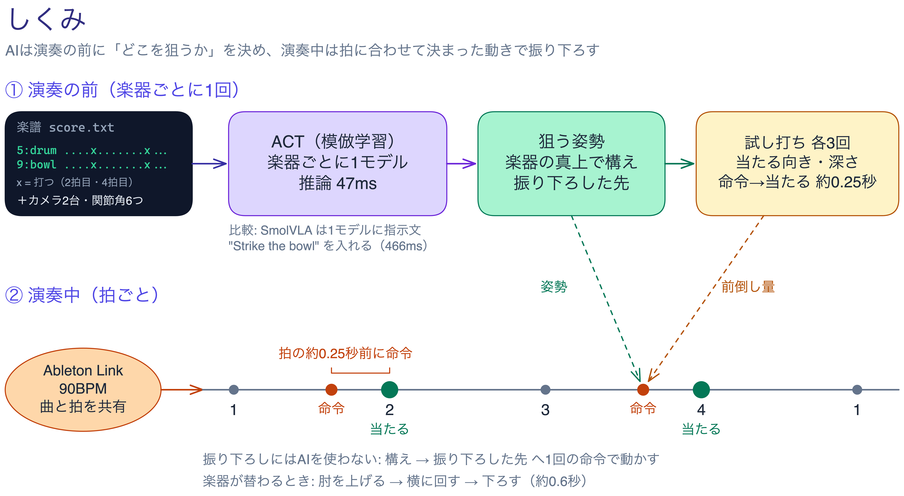

# SO-101 Robot Drummer

SO-101 アーム（LeRobot）が、曲に合わせて2つの打楽器（おもちゃのドラムと、伏せたステンレスのボウル）を叩き分けるプロジェクト。
叩く場所はAI（模倣学習の ACT）が決め、振り下ろしは決まった動きにして Ableton Link の拍に合わせる。

- 動画: https://youtu.be/h5nsWipI0aA
- 曲: 自作曲（90BPM、`song/build_song.py` で Ableton Live に組む）



## しくみ

1. **演奏の前（楽器ごとに1回）**
   - 構えの姿勢で、正面カメラと手首カメラの映像、6つの関節角から、楽器ごとに学習した ACT が動きの列（100ステップ）を推論する。
   - 列の中で肘がいちばん下がった姿勢を「打撃姿勢」、そこから肘だけ上げた姿勢を「照準姿勢」（楽器の真上で待つ）とする。
   - 楽器ごとに3回ずつ試し打ちをして、当たる向きと深さ、命令を出してから当たるまでの時間（約0.24〜0.27秒）を測る。
2. **演奏中（拍ごと）**
   - Ableton Link でテンポと拍を Live と共有する（90BPM、quantum 4）。
   - 楽譜（`song/score.txt`、1小節16ステップ）の打点ごとに、拍より「命令→当たる」の時間だけ前に、照準姿勢から打撃姿勢へ1回の命令を出す。
   - 振り下ろしにAIは使わない。ACT の出力をそのまま再生すると、当たる瞬間が ±50〜140ms ばらついて拍に乗らなかったため。
   - 楽器を替えるときは、肘を上げる → 横に回す → 下ろす の順で約0.6秒かけて移動する。

## SO-101 入門サンプルからの発展点

| サンプル | このプロジェクト |
|---|---|
| 1つの物をつかんで置く | 2つの楽器を、楽譜の指示（drum / bowl）で叩き分ける |
| ポリシーの出力をそのまま実行 | AIの照準と、拍に合わせた固定の振り下ろしを組み合わせる |
| 時間の制約なし | 曲と拍単位で同期する（Ableton Link、命令を拍の前に出す） |
| 1つの手法 | ACT（楽器ごとに1モデル）と SmolVLA（指示文 "Strike the drum" / "Strike the bowl" で1モデル）を比べる |

## 結果

- ACT の演奏3回（各44打）は、映像で見て全打が楽器に当たった。
- 打点と拍のずれは平均 +1〜3ms（曲を鳴らさない基準測定で、Link の拍に対して）。
- SmolVLA も狙う向きは ACT と同じ（+19°）だったが、ボウルの端に当たった。推論時間は ACT 47ms、SmolVLA 466ms（Apple Silicon、MPS）。
- マイクの打音による当たり判定は、曲をスピーカーで鳴らすと打音が埋もれて誤って空振りと判定した。そのため当たりは映像で確かめた。

## 限界

- 楽器の位置、照明、机の外の背景（手首カメラに映る物）が変わると、ACT の照準がずれる。机の外の物の配置が変わった日は照準が −8° になり、背景を戻すと +13〜18° に戻った。学習データ24本はすべて同じ配置で録ったので、配置の違いへの汎化は扱っていない。
- Link が補正するのは Live が把握している出力の遅れまで。撮影時はスピーカー側の遅れで、曲が拍より約0.1〜0.2秒遅れて聞こえていた。動画の曲は、Ableton から書き出した音源を Link の拍に合わせて重ねている（打音は撮影時の音）。

## ファイル

| パス | 内容 |
|---|---|
| `scripts/strike_conductor.py` | 演奏の本体（推論 → 試し打ち → Link に合わせて楽譜どおりに打つ。`--sim` でロボット無しの検証） |
| `scripts/strike_policy.py` | ポリシーの読み込みと観測の変換、1回の試行（照準の評価） |
| `scripts/strike_sync.py` | 当たりの検出と、シミュレーション用のアーム |
| `scripts/strike_spike.py` | 振り下ろしの遅れの測定、ポートの設定、leader での構えの指定 |
| `scripts/wrist_align.py` | 手首カメラの映像を学習時の基準画像と比べ、背景のずれを確認する |
| `scripts/align_camera.py` | 正面カメラの画角を基準画像に合わせる |
| `scripts/trim_strikes.py` / `scripts/qc_dataset.py` | 録画したデータの切り出しと確認 |
| `scripts/offline_lang_check.py` / `scripts/smolvla_latency.py` | SmolVLA の指示文の効き方と推論時間の確認 |
| `scripts/mic_check.py` / `scripts/camera_probe.py` | マイクとカメラの確認 |
| `song/build_song.py` / `song/score.txt` | 曲の音符（和音・ベース・ベル・ハイハット）を Live に打ち込む / ロボットの楽譜 |
| `video/build_video.py` | 提出動画の編集（ffmpeg） |
| `video/mask_takes.py` | 撮った映像の、台と腕が動く範囲より外側にモザイクをかける（手持ちで動くカメラを天板の特徴点で追う） |
| `video/diagram/` | しくみの図（Excalidraw） |
| `refs/` | 学習時の正面と手首カメラの基準画像、演奏の日の手首カメラ画像 |

## 環境

- macOS（Apple Silicon）、Python 3.12、`lerobot[feetech,smolvla]==0.6.1`、PyTorch 2.11（推論は MPS）
- `aalink`（Ableton Link）、`sounddevice`、Ableton Live（Link を ON）
- 学習は CUDA の GPU で行った（下記）

ポートは `lerobot-find-port` で調べ、環境変数で渡す。

```bash
export SO101_FOLLOWER_PORT=/dev/cu.usbmodemXXXX
export SO101_LEADER_PORT=/dev/cu.usbmodemYYYY
```

## 再現の手順

1. **データ**: `lerobot-record` で、正面（俯瞰）と手首の2カメラ、30fps で叩く動きを録る。ドラムとボウルを交互に24本。タスク文は `Strike the drum` / `Strike the bowl`。データセット名は `local/so101-strike-mix` とする。
2. **学習**
   - ACT は楽器ごとに1つ: `lerobot-train --policy.type=act --dataset.repo_id=local/so101-strike-mix --dataset.episodes='[...]' --steps=20000 --batch_size=8`（chunk_size 100、学習率 1e-5、resnet18）。drum の episode は `[0,1,3,5,7,9,10,12,14,17,19,21]`、bowl は `[2,4,6,8,11,13,15,16,18,20,22,23]`。
   - SmolVLA は全24本で1つ: `--policy.path=lerobot/smolvla_base --steps=6000 --batch_size=64`。カメラ名を `--rename_map='{"observation.images.front": "observation.images.camera1", "observation.images.wrist": "observation.images.camera2"}'` で対応づける。
3. **曲**: `song/build_song.py` は Live をコマンドで操作するツール（`ableton` コマンド。AbletonMCP の Remote Script 経由）で曲を打ち込む。このツールが無い場合は、`build()` が返す音符（90BPM・24小節）を Live に手で打ち込めば同じ曲になる。ロボットの楽譜 `song/score.txt` は `python -c "from song.build_song import score; print(score())"` でも出せる。
4. **演奏**: Live の Link を ON にして、次を実行する。

   ```bash
   python scripts/strike_conductor.py act --score song/score.txt --song-tracks 0,1,2,3,4 \
     --ckpt-drum outputs/train/act_mix_drum/last --ckpt-bowl outputs/train/act_mix_bowl/last
   ```

   ロボット無しで流れとタイミングを確かめるときは `--sim` を付ける。
